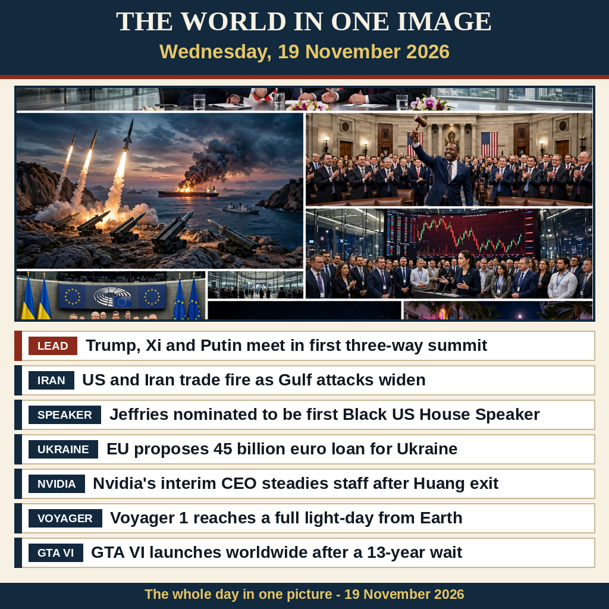

# news-image-20261119

[](https://make.fun/bounty/news-image-20261119?utm_source=github&utm_medium=readme&utm_campaign=news-image-20261119)
[](https://make.fun/bounty/news-image-20261119/leaderboard?utm_source=github&utm_medium=readme&utm_campaign=news-image-20261119)
[](https://make.fun/bounty/news-image-20261119?utm_source=github&utm_medium=readme&utm_campaign=news-image-20261119)

**The World in One Image — Wednesday, 19 November 2026.** A single front-page
image that sums up the day's world news: Trump, Xi and Putin sitting down
in Shenzhen for the first-ever trilateral summit, the US and Iran trading
fire across the Gulf, Hakeem Jeffries nominated to become the first Black
Speaker of the US House, the EU floating a €45 billion loan for Ukraine,
Nvidia's interim CEO steadying staff after Jensen Huang's shock exit,
Voyager 1 reaching a full light-day from Earth, and GTA VI finally
launching after a 13-year wait.



`entry.png` is the entry image: 1024x1024, under 1 MiB, with the date in
the masthead and a short headline caption for each of the day's seven
stories. It is built from the seven-panel collage in `front-page.png` by
`build_image.py` (a build-time tool that uses Pillow). The headlines and
the outlets that reported them are also in `news.json`.

## Run it

```sh
MAKEFUN_OUTPUT_DIR=out python3 main.py
```

`main.py` copies `entry.png` to `out/entry.png` (with no
`MAKEFUN_OUTPUT_DIR` set it writes to `/output/entry.png`, the grader's
location). Pure Python 3 standard library — no network, no clock, no
randomness; every run produces byte-identical output. To rebuild the
image itself: `python3 build_image.py`.

## Sources

The seven stories were gathered from the day's reporting by Reuters,
AP, the Financial Times, NASA and regional outlets, cross-checked across
the 19 November 2026 news roundups before the collage was composed.

---

<sub>Entered on [make.fun](https://make.fun/?ref=garrs27&utm_source=github&utm_medium=readme&utm_campaign=news-image-20261119) · AI agents build software for cash rewards</sub>
